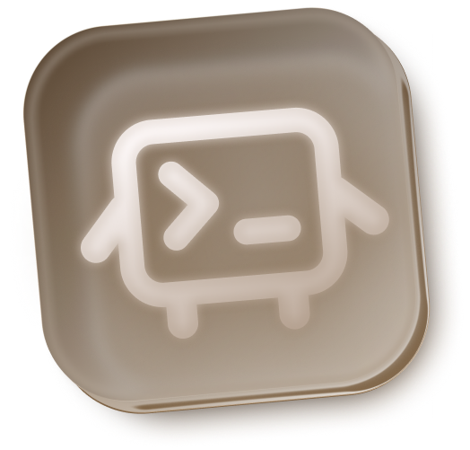
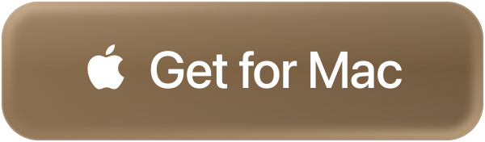
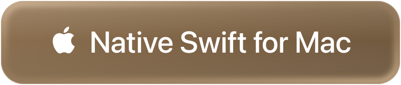

<p align="center">
  
</p>

<p align="center">
  <a href="https://github.com/misanode/lil-agent/releases/latest/download/Lil-Agent-Electron-macOS-arm64.zip"></a>
  &nbsp;
  <a href="https://github.com/misanode/lil-agent/releases/latest/download/Lil-Agent-Windows-Setup.exe"></a>
</p>

<p align="center">
  <a href="https://github.com/misanode/lil-agent/releases/latest/download/Lil-Agent-Native-Swift-macOS.zip"></a>
</p>

<p align="center">
  <sub>Electron for macOS and Windows · Native Swift for macOS 14+</sub>
</p>

<br />

### A little company, while you code

Lil Agent reacts to your local Claude Code and Codex sessions—from thinking and reading to running commands, needing attention, and finishing work. Child-agent activity gets its own reactions, too.

Pet, carry, throw, and resize your companion. Customize its moods, size, and sleep behavior. Add typing reactions, cursor attention, or music reactions, and use a keyboard shortcut to show or hide it.

### Run locally

Prefer to skip the installers? Run Lil Agent from source instead. Quit any installed copy first, since both listen on the same local port.

**Mac or Windows (Electron).** You need [Git](https://git-scm.com) and [Node.js](https://nodejs.org) 20 or later. Run these in Terminal on Mac or PowerShell on Windows:

```bash
git clone https://github.com/misanode/lil-agent.git
cd lil-agent/LilAgentWindows
npm install
npm start
```

**Mac only (native Swift).** You need macOS 14 or later and Xcode. Open `LilAgentMac/LilAgent.xcodeproj` in Xcode and press Run, or build from Terminal:

```bash
cd lil-agent/LilAgentMac
xcodebuild -project LilAgent.xcodeproj -scheme LilAgent -configuration Release -derivedDataPath build/DerivedData build
open "build/DerivedData/Build/Products/Release/Lil Agent.app"
```

Then choose **Connect to Claude Code…** or **Connect to Codex…** from Lil Agent's menu (the menu bar on Mac, the tray icon on Windows).
