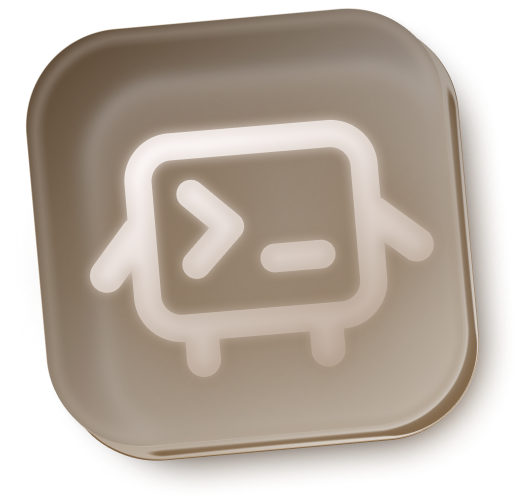
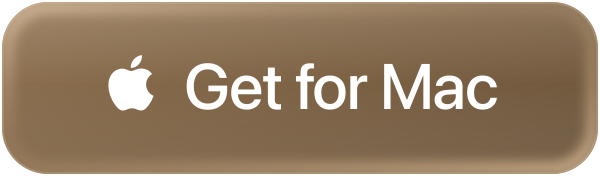
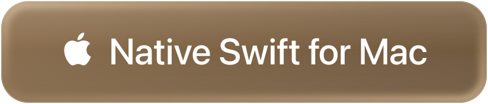

  

  
  &nbsp;
  

  

  Electron for macOS and Windows · Native Swift for macOS 14+

 

### A little company, while you code

Lil Agent reacts to your local Claude Code and Codex sessions—from thinking and reading to running commands, needing attention, and finishing work. Child-agent activity gets its own reactions, too.

Pet, carry, throw, and resize your companion. Customize its moods, size, and sleep behavior. Add typing reactions, cursor attention, or music reactions, and use a keyboard shortcut to show or hide it.
