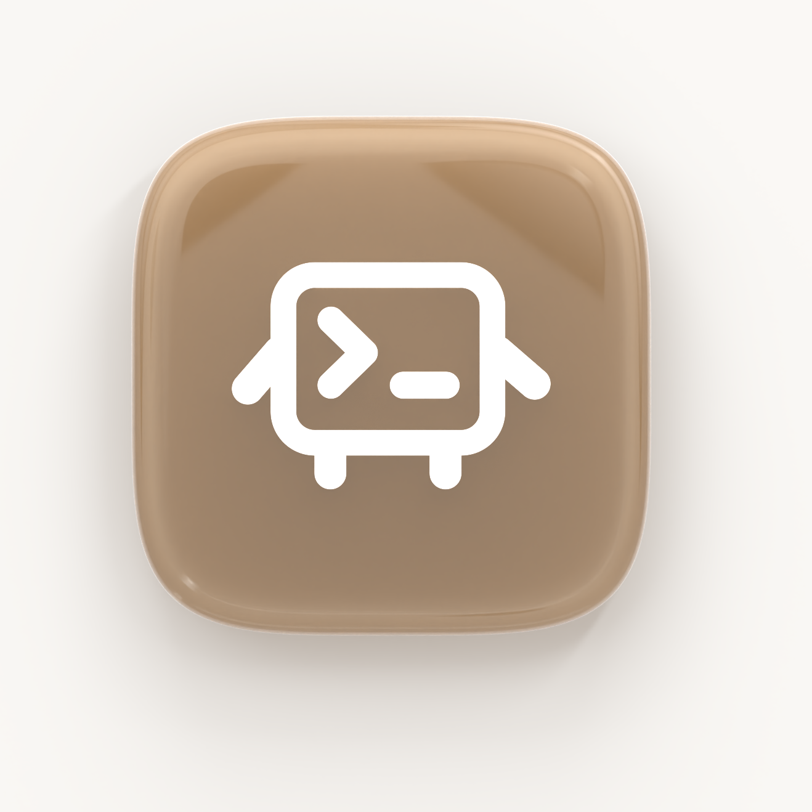

# 3D logo tile render (v3)

How the 3D glass app-tile render is made, and how to make one for a different logo or colour.

It's fully scripted: `glass_tile.py` builds the scene in Blender and renders it, and `compose.py` places the result on the page background with a tinted shadow. No clicking in Blender. Tested with **Blender 5.2** (Cycles on the Apple Metal GPU) on macOS.

```
render-src/
  glass_tile.py   # builds the scene + renders a multilayer EXR
  logo-robot-only.svg   # Lil Agent logo without the sparkles (used for the current render)
  compose.py      # EXR → PNG on the page colour (+ a transparent PNG)
  renders/
    glass-tile-on-paper.png      # opaque, on #faf8f5; use this on the site
    glass-tile-transparent.png   # same render on a transparent background
```



---

## Make one with a new logo

```sh
cd website/render-src
B=/Applications/Blender.app/Contents/MacOS/Blender

# Quick preview (~20 s): small and noisy, for checking the look. Swap LOGO_SVG for any new logo.
LOGO_SVG=$PWD/logo-robot-only.svg $B -b -P glass_tile.py -- /tmp/preview 48 600
$B -b --python compose.py -- /tmp/preview && open /tmp/preview-on-paper.png

# Final (~7 min on an M-series Mac)
LOGO_SVG=$PWD/logo-robot-only.svg $B -b -P glass_tile.py -- renders/glass-tile 512 1800
$B -b --python compose.py -- renders/glass-tile
mv renders/glass-tile.png renders/glass-tile-transparent.png && rm renders/glass-tile.exr
```

Arguments after `--`: `<output prefix> [samples=128] [resolution=900]`. Every setting below is an environment variable, so put it in front of the command, e.g. `RIM='#3f6fd8' FACE='#a9c9f7' LOGO_SVG=… $B -b -P glass_tile.py -- …`. Pass the same `PAPER`/`SHADOW_TINT` to `compose.py`.

### Logo SVG requirements
- **Filled shapes only.** Strokes don't import. Outline them first: *Outline stroke* in Figma, *Object → Expand* in Illustrator.
- Single colour (any colour; the script makes it white).
- Holes (like the inside of the Lil Agent screen) must be cut-outs within the same path. Each SVG path is filled on its own, so holes stay holes.
- The Lil Agent source logo is `LilAgentMac/Art/Brand/Source/lil-agent-logo.svg`. The current render uses `render-src/logo-robot-only.svg`, the same file with the two sparkle paths (paths 2 and 3) removed. Use the full logo to get the sparkles back.

### Settings

**Colour** (the main thing to change for a new brand)

| Variable | Default | What it does |
|---|---|---|
| `RIM` | `#7a4a20` | Deep colour the glass takes where it's thick: edges, walls, bevels. A darker, more saturated version of the brand colour. |
| `FACE` | `#e3c49d` | Light, milky colour of the face and inner haze. A lighter version of the brand colour. |
| `SHADOW_TINT` *(compose)* | `#a8875f` | Colour cast in the shadow. A mid-tone of the brand colour. |
| `PAPER` *(compose)* | `#faf8f5` | Website background. The `-on-paper` PNG uses exactly this colour, so it blends in seamlessly. |

Recipe: `FACE` is the brand colour lightened about 35%, `RIM` is it darkened about 20% and a bit more saturated, and `SHADOW_TINT` sits between them. A blue like Cluely's would be `FACE=#a9c9f7 RIM=#3f6fd8 SHADOW_TINT=#8fa8e8`.

**Glass**

| Variable | Default | What it does |
|---|---|---|
| `GLOSS_ROUGH` | `0.08` | Surface roughness. 0.05–0.1 gives the wet, polished jelly gloss; higher is more frosted. |
| `ABSORB` | `1.5` | How strongly thick areas take on the `RIM` colour. Higher gives deeper edges, but the whole tile darkens fast; 3+ goes muddy. |
| `HAZE` | `3.6` | Milky inner scattering. Higher gives a more frosted, luminous core. |
| `RIM_GLOW` | `3.0` | Brightness of the razor-thin fresnel line on the outer ridge. |

**Shape**

| Variable | Default | What it does |
|---|---|---|
| `THICK` | `0.3` | Slab thickness, where the tile is 2.0 wide. |
| `SQUIRCLE` | `4.2` | Corner shape (superellipse exponent). 2 is a circle; around 4–5 is the continuous-curvature "Apple icon" squircle; higher is squarer. |
| `BULGE` | `0.02` | How far the side walls swell outward like a lens. 0 gives straight walls. |
| `LOGO_SCALE` | `0.62` | Logo width as a fraction of the tile. |
| `LOGO_COLOR` | `#fbf8f3` | Logo colour (warm off-white). |
| `DISH` | `1` | `1` gives a shallow dished face with a raised lip around it, like a keycap. `0` gives a flat face. |
| `DISH_INSET`, `DISH_DEPTH` | `0.16`, `0.06` | Width of the lip and how deep the dish sinks. Through the glass, the lip reads as a darker ring around a lighter centre. |
| `EMBED` | `0.006` | How far the logo sits *under* the (dished) top surface. Deeper looks more embedded but tints the logo with the glass colour; 0.018 already turned it yellow. |

**Lighting / framing**

| Variable | Default | What it does |
|---|---|---|
| `REFL` | `3.0` | Main softbox reflection brightness: the wide, feathered highlight curving over the **top-right** corner. |
| `COOL_REFL` | `1.1` | Secondary cool-toned (bluish) reflection on the top-left, for warm-versus-cool contrast on the gloss. |
| `REFL_X`, `REFL_Y`, `REFL_ANGLE` | `1.7`, `1.6`, `-35` | Where the softbox hangs and how it's turned, which moves the reflection on the face. |
| `SOFTBOX_W`, `SOFTBOX_H` | `5.0`, `3.0` | Softbox size. Bigger gives a broader, softer reflection. |
| `TILT_X`, `TILT_Y` | `0`, `0` | Tilt in degrees. `0` faces the viewer straight on (current). Small negative values, like `-10` and `-13`, show the right and bottom walls for a 3/4 look. |
| `SPIN` | `0` | Rotation in degrees around the facing axis. Positive turns it counter-clockwise (top edge rising to the right). |
| `LIFT` | `0.2` | Height of the tile above the floor. Lower gives a darker contact shadow; higher, a floatier, softer shadow. |
| `SHADOW_STRENGTH` *(compose)* | `1.0` | Overall shadow darkness. |
| `PAD` *(compose)* | `0.78` | Crop margin around the tile. Bigger leaves more empty background. |

---

## How the scene is built

### 1. Shape: squircle slab with lens-like walls
- The outline is a **superellipse** (`|x|ⁿ + |y|ⁿ = 1`, n = `SQUIRCLE`) with 192 points. That gives continuous-curvature corners, a true squircle, instead of a square with circular corners, which looks abrupt where the curve starts.
- The slab is built from **5 stacked rings** of that outline. The middle rings are scaled up by `BULGE`, so the side walls swell outward like a lens. That refracts light at the edges and gives the chunky, tactile weight.
- **Dish:** the top cap is inset by `DISH_INSET` and sunk by `DISH_DEPTH` (`bmesh.ops.inset_region`), leaving a raised lip around a shallow dished face, like a keycap.
- A narrow, angle-limited **Bevel** (0.07, 12 segments) softens the lip where the face meets the wall.

### 2. Glass material: jelly or optical glass
- **Principled BSDF:** transmission 1.0, roughness `GLOSS_ROUGH` 0.08 (wet, polished), IOR 1.47, base colour `FACE`. A clear **coat** (1.0, roughness 0.06) gives the wet, glossy top layer and sharp highlights.
- **Volume** = *Absorption* (`RIM`, density `ABSORB`) + *Scatter* (`FACE`, density `HAZE`). This creates the signature look: light passing through the thick bulging walls travels further, so the rim goes deep and saturated, while the face stays light and milky.
- With a glossy surface you see deep into the glass, so the centre gets dark unless the volume is mostly **haze** (scatter 3.6) with light **absorption** (1.1), plus a strong back light. That combination gives the pale, milky core with light trapped inside. A deep, saturated `RIM` colour still darkens only the long paths through the edges.
- **Fresnel rim glow:** a *Layer Weight → Facing* value, run through a tight colour ramp (0.86 → 0.97), mixes in a warm-white emission only where the surface turns away from the camera. The result is a razor-thin bright line on the outer ridge, like polished glass catching light.

### 3. Logo: embedded, not a sticker
- Each SVG path is imported, filled flat, converted to a mesh, then joined. Converting before joining keeps the holes correct; joining the curves first broke them.
- It's centred, scaled to `LOGO_SCALE`, and given a 0.012 Solidify plus a tiny 0.004 bevel for soft edges.
- It sits `EMBED` (0.006) **below** the top face, so it's seen through a skin of glass. That adds subtle softness and lets it pick up the coat's reflections, so it reads as inside the block.
- Material: white, roughness 0.6, emission 0.7, so it stays crisp white even under the glass. With less emission, or deeper embedding, it picks up a yellow tint.

### 4. Pose
An empty pivot at height `LIFT` rotates the tile by `(TILT_X, TILT_Y, SPIN)`. The current render uses `(0, 0, 0)`: perfectly straight on, so only the face and its rounded lip show. An earlier version used `(-10°, -13°, +10°)` for a playful 3/4 angle with the right and bottom walls showing. The camera always stays straight above with no roll; an off-axis, look-at camera once skewed it into looking like it was turning away up-left.

### 5. Lights
| Light | Size / power | Placement | Purpose |
|---|---|---|---|
| Key | 9 m area, 820 W | high, top-left | overall soft light and the main edge highlights |
| Strip | 0.6 × 5 m, 260 W | top-right | extra light on the top-right |
| Fill | 8 m, 120 W | front-right | lifts the shadow side |
| Back | 6 m, 950 W | behind, low | shines *through* the glass, so the edges glow |
| World | white, 1.0 | everywhere | the high-key, airy studio look |

**All lights are hidden from reflections** (`visible_glossy = False`). Hard-edged area lights reflected as harsh diagonal stripes across the glossy face. Reflections come only from the feathered softbox cards (next section).

### 6. Softbox reflections
**Main:** a wide plane hovering above the **top-right**, with an emission shader whose strength fades out radially (*Spherical Gradient → Color Ramp*). It's **hidden from the camera, shadows, diffuse light and the glass's see-through rays**, so it only appears in reflections. That gives a soft, feathered studio-softbox gloss curving over the top-right corner, instead of a hard stripe.

**Secondary:** a copy of that card over the top-left, tinted cool blue (`0.82, 0.9, 1.0`) at low strength (`COOL_REFL`), for a subtle warm-versus-cool contrast on the gloss.

### 7. Floor, camera, render
- **Floor:** a large plane set as a shadow catcher. It's invisible and only records the shadow. With the tile low (`LIFT` 0.2), you get a tight contact shadow under the bottom edge that bleeds out into the soft, warm-tinted glow.
- **Camera:** 110 mm lens, **directly above the tile with no rotation**, for a flat product-shot perspective. Don't aim it with a look-at at an off-centre point: that adds roll and skews the tile. Re-frame with the crop instead.
- **Cycles:** GPU (Metal), denoised, 24 transmission bounces, refractive caustics on, and the *Standard* view transform so the chosen colours come out exactly (AgX washes them out). The film is transparent, and it writes a **multilayer EXR** with the *Shadow Catcher* pass.

### 8. Compositing (`compose.py`)
Runs inside Blender's Python, which includes NumPy and OpenImageIO:
1. Reads `Combined` (premultiplied) and `Shadow Catcher` from the EXR.
2. shade = (1 − mean(Shadow Catcher)) × `SHADOW_STRENGTH`
3. background = `PAPER` × (1 − shade × (1 − `SHADOW_TINT` × 0.55)), a soft shadow in the brand colour.
4. result = Combined + background × (1 − alpha), converted to sRGB, cropped square around the tile (centred on it, nudged down for the shadow, margin `PAD`), saved as `-on-paper.png`. A transparent `.png` is saved too.

---

## Gotchas (learned the hard way)
- **Blender 5.x EXR:** set `image_settings.media_type = 'MULTI_LAYER_IMAGE'` *then* `file_format = 'OPEN_EXR_MULTILAYER'`. The old enum alone errors.
- **OpenImageIO:** `read_image(subimage, miplevel, …)` needs the subimage index as its first argument, or every layer reads as the first one.
- **2D curves** can't have location or rotation applied. Convert to a mesh first, then transform.
- **Too bright?** Glass plus a white world overexposes easily, and an overexposed render looks pale cream. Check the pixel values in the EXR; around 1.0 on the face is right.
- **Washed-out colour?** Use the *Standard* view transform, not AgX.
- **Diagonal stripes across the face?** Those are reflections of area lights. Hide lights from glossy rays and use feathered emissive cards for highlights.
- **Face too dark or brown with a glossy surface?** Lower `ABSORB`, raise `HAZE`, and add more back light.
- **Logo turning the glass colour?** Lower `EMBED` or raise the logo's emission.
- Always do a 48-sample, 600 px preview before the ~7-minute final.

## Using a render on the website
The hero image is `` in `website/index.html`. Copy the render into `website/assets/` (resize it to around 600–800 px and compress it), point `src` at it, and set matching `width`/`height`. The `-on-paper` version only blends in on `#faf8f5`; use the transparent version on any other background.
